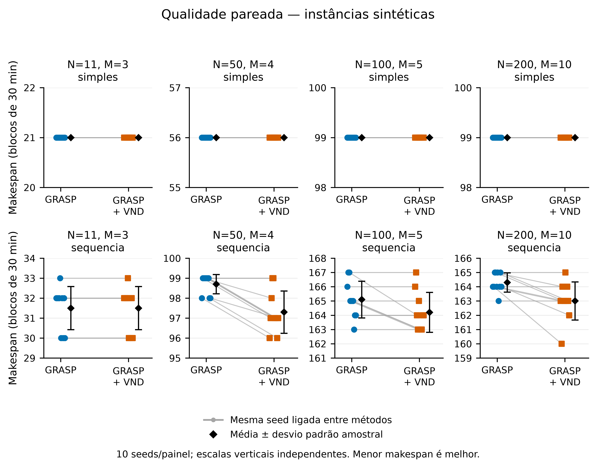
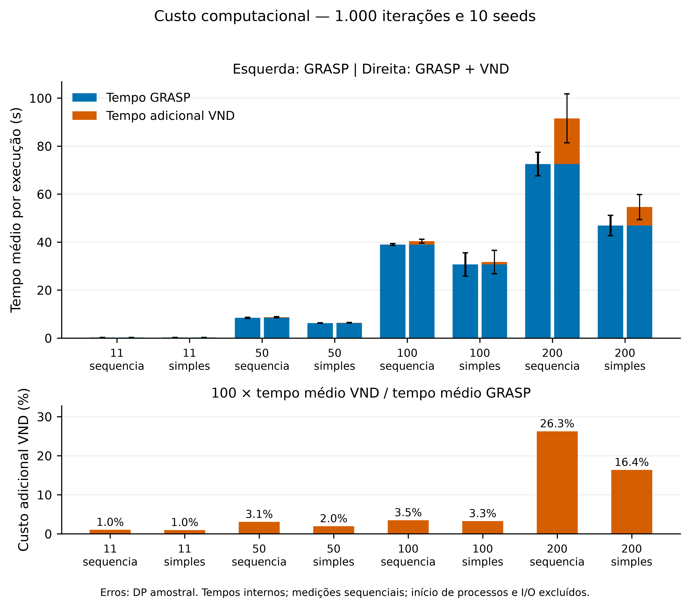
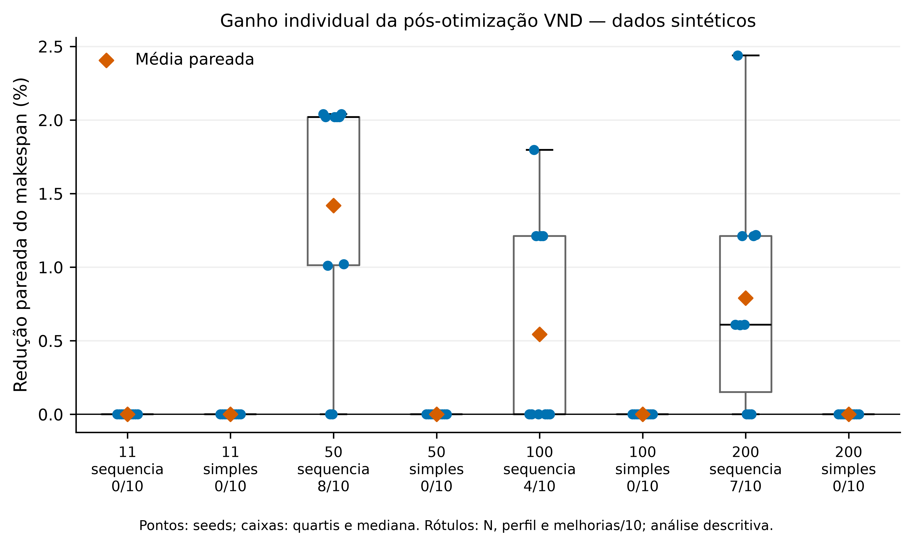

# Resultados do experimento principal reduzido

## Configuração e integridade

Foram avaliadas as mesmas **oito instâncias SINTÉTICAS do piloto**, nos perfis `simples` e `sequencia`, com N=11, 50, 100 e 200 cirurgias. Não são dados hospitalares reais nem uma reprodução dos resultados originais do artigo.

Cada instância foi executada com **1.000 iterações GRASP, alpha=0,5 e 10 seeds, 0 a 9**. O VND foi aplicado uma única vez à cópia exata da melhor solução final de cada GRASP. O custo GRASP é compartilhado na comparação pareada; não houve nova execução GRASP para a versão com VND. Execuções sequenciais, sem testes ou geração de gráficos concorrentes às medições.

Os **85 testes passaram em 2,14 s antes de iniciar**. Os hashes do código e das instâncias foram conferidos contra o piloto antes e depois do lote. GRASP, construção, N1, N2, VND, objetivo e comparação permaneceram inalterados. Todos os arquivos de resultados e a documentação anterior do piloto foram preservados.

A verificação após a execução incluiu os três testes novos da análise: **88 testes passaram em 2,61 s**, cobrindo percentuais pareados, preservação de precisão e recusa de publicação de lote parcial.

Ambiente de execução: Python 3.12.6; Windows-11-10.0.26200-SP0; processador `Intel64 Family 6 Model 186 Stepping 2, GenuineIntel`; 12 CPUs lógicas. A disponibilidade de múltiplos núcleos não foi usada para paralelizar o lote.

Início: **25/10/2026 12:34:30 -03**; fim: **25/10/2026 13:14:12 -03**, no fuso America/Sao_Paulo. O manifesto preserva também os horários UTC originais.

| Instância SINTÉTICA | N | Salas | Perfil | Seed de geração |
| --- | ---: | ---: | --- | ---: |
| SINTETICA-11-S3-sequencia-seed2020 | 11 | 3 | sequencia | 2020 |
| SINTETICA-11-S3-simples-seed2020 | 11 | 3 | simples | 2020 |
| SINTETICA-50-S4-sequencia-seed2022 | 50 | 4 | sequencia | 2022 |
| SINTETICA-50-S4-simples-seed2022 | 50 | 4 | simples | 2022 |
| SINTETICA-100-S5-sequencia-seed2024 | 100 | 5 | sequencia | 2024 |
| SINTETICA-100-S5-simples-seed2024 | 100 | 5 | simples | 2024 |
| SINTETICA-200-S10-sequencia-seed2026 | 200 | 10 | sequencia | 2026 |
| SINTETICA-200-S10-simples-seed2026 | 200 | 10 | simples | 2026 |

As seeds de geração identificam o arquivo fixo de entrada. As seeds 0..9 controlam o GRASP; não geram novas instâncias.

Comando efetivamente executado na raiz:

```powershell
.\.venv\Scripts\python.exe -m pytest -q
.\.venv\Scripts\python.exe -u scripts/piloto_experimental.py --iteracoes 1000 --seeds 0 1 2 3 4 5 6 7 8 9 --alpha 0.5 --limite-execucao 300 --limite-total 7200 --saida resultados/principal_reduzido
```

Os limites de 300 s por execução e 7.200 s no total foram mantidos. O executor salva JSON individual e atualiza os CSVs após cada comparação; recusa sobrescrever saídas existentes.

## Execução efetiva

Estado final: **concluido**, **80/80 comparações concluídas**. Tempo de parede efetivo: **2381,854440 s (39,70 min)**, sem timeout ou falha. Soma dos tempos internos dos algoritmos: **2338,724505 s**; GRASP: 2043,905548 s; adicional VND: 294,818957 s.

O tempo de parede inclui inicialização de 80 processos, leitura dos arquivos, serialização, verificações externas, checkpoints e comunicação. Os tempos internos vêm de `perf_counter` e incluem as validações internas dos algoritmos; não incluem geração posterior de gráficos, análise ou testes. Por isso, a soma dos tempos internos difere do tempo de parede.

## Qualidade por instância

Makespan em **blocos de 30 minutos**. Menor é melhor. Média e DP amostral (denominador n−1) são calculados nas 10 seeds de cada instância. A redução é a média dos percentuais **pareados**, `100*(G−V)/G`, não a razão entre médias. Os melhores valores de cada método são mínimos sobre seeds e não necessariamente pertencem ao mesmo par.

| N / salas / perfil | Melhor G | Média G | DP G | Melhor G+VND | Média G+VND | DP G+VND | Redução média pareada (%) |
| --- | ---: | ---: | ---: | ---: | ---: | ---: | ---: |
| 11 / 3 / sequencia | 30 | 31,500 | 1,080 | 30 | 31,500 | 1,080 | 0,000 |
| 11 / 3 / simples | 21 | 21,000 | 0,000 | 21 | 21,000 | 0,000 | 0,000 |
| 50 / 4 / sequencia | 98 | 98,700 | 0,483 | 96 | 97,300 | 1,059 | 1,419 |
| 50 / 4 / simples | 56 | 56,000 | 0,000 | 56 | 56,000 | 0,000 | 0,000 |
| 100 / 5 / sequencia | 163 | 165,100 | 1,287 | 163 | 164,200 | 1,398 | 0,543 |
| 100 / 5 / simples | 99 | 99,000 | 0,000 | 99 | 99,000 | 0,000 | 0,000 |
| 200 / 10 / sequencia | 163 | 164,300 | 0,675 | 160 | 163,000 | 1,333 | 0,791 |
| 200 / 10 / simples | 99 | 99,000 | 0,000 | 99 | 99,000 | 0,000 | 0,000 |

## Frequência e magnitude das melhorias

| N / salas / perfil | Com melhoria | Melhoria (%) | Sem melhoria | Mediana da redução (%) | Maior redução individual (%) | Realocações aceitas (total) |
| --- | ---: | ---: | ---: | ---: | ---: | ---: |
| 11 / 3 / sequencia | 0/10 | 0,0 | 10 | 0,000 | 0,000 | 0 |
| 11 / 3 / simples | 0/10 | 0,0 | 10 | 0,000 | 0,000 | 0 |
| 50 / 4 / sequencia | 8/10 | 80,0 | 2 | 2,020 | 2,041 | 10 |
| 50 / 4 / simples | 0/10 | 0,0 | 10 | 0,000 | 0,000 | 0 |
| 100 / 5 / sequencia | 4/10 | 40,0 | 6 | 0,000 | 1,796 | 5 |
| 100 / 5 / simples | 0/10 | 0,0 | 10 | 0,000 | 0,000 | 0 |
| 200 / 10 / sequencia | 7/10 | 70,0 | 3 | 0,610 | 2,439 | 9 |
| 200 / 10 / simples | 0/10 | 0,0 | 10 | 0,000 | 0,000 | 0 |

No conjunto observado, o VND melhorou **19/80 execuções (23,75%)**, não alterou o makespan em **61** e não piorou nenhuma. A redução média pareada entre as 80 execuções foi **0,344%**, e a mediana foi 0,000%. Essa média global dá o mesmo peso a cada uma das oito instâncias, pois todas têm 10 execuções; não é uma métrica de desempenho clínico.

## Custo computacional

Tempos médios em segundos por execução. Custo adicional = `100*tempo_médio_VND/tempo_médio_GRASP`; é uma razão das médias. Total = GRASP + VND, com uma única execução GRASP.

| N / salas / perfil | GRASP médio (s) | VND adicional médio (s) | Total médio (s) | Custo adicional (%) |
| --- | ---: | ---: | ---: | ---: |
| 11 / 3 / sequencia | 0,263914 | 0,002723 | 0,266637 | 1,03 |
| 11 / 3 / simples | 0,262039 | 0,002570 | 0,264609 | 0,98 |
| 50 / 4 / sequencia | 8,434728 | 0,258928 | 8,693656 | 3,07 |
| 50 / 4 / simples | 6,264877 | 0,122461 | 6,387338 | 1,95 |
| 100 / 5 / sequencia | 39,009155 | 1,362707 | 40,371862 | 3,49 |
| 100 / 5 / simples | 30,689405 | 1,001899 | 31,691304 | 3,26 |
| 200 / 10 / sequencia | 72,534625 | 19,045491 | 91,580117 | 26,26 |
| 200 / 10 / simples | 46,931812 | 7,685116 | 54,616928 | 16,38 |

Considerando a soma de todos os tempos GRASP como base, o VND acrescentou **14,42%** de tempo computacional. Esse valor global pondera mais as instâncias demoradas e difere da média simples dos percentuais da tabela.

## Melhores e piores casos observados

Cinco maiores reduções individuais (empates ordenados por identificador e seed):

| Instância SINTÉTICA | Seed | GRASP | Após VND | Redução (%) | Realocações |
| --- | ---: | ---: | ---: | ---: | ---: |
| SINTETICA-200-S10-sequencia-seed2026 | 1 | 164 | 160 | 2,439 | 2 |
| SINTETICA-50-S4-sequencia-seed2022 | 0 | 98 | 96 | 2,041 | 1 |
| SINTETICA-50-S4-sequencia-seed2022 | 8 | 98 | 96 | 2,041 | 2 |
| SINTETICA-50-S4-sequencia-seed2022 | 1 | 99 | 97 | 2,020 | 1 |
| SINTETICA-50-S4-sequencia-seed2022 | 5 | 99 | 97 | 2,020 | 1 |

Menor ganho estritamente positivo: `SINTETICA-200-S10-sequencia-seed2026`, seed 2, makespan **165 → 164**, redução 0,606%.

O menor ganho observado foi **0%**, em 61 execuções. Entre elas, o maior custo adicional VND ocorreu em `SINTETICA-200-S10-simples-seed2026`, seed 0: **9,829161 s**, mantendo makespan 99. Ausência de redução não significa falha de implementação nem certifica ótimo global.

## Interpretação científica

Houve alguma melhoria em **3/8 instâncias**. As instâncias sem redução nas 10 seeds foram: `SINTETICA-11-S3-sequencia-seed2020`; `SINTETICA-11-S3-simples-seed2020`; `SINTETICA-50-S4-simples-seed2022`; `SINTETICA-100-S5-simples-seed2024`; `SINTETICA-200-S10-simples-seed2026`.

A maior redução média pareada ocorreu em **50 / 4 / sequencia**, com 1,419% e melhoria em 8/10 seeds. O efeito é específico ao arquivo e às seeds avaliados; a classe de instâncias inteira não foi amostrada.

Em 100 / 5 / sequencia, houve redução da média sem alteração do melhor valor observado sobre as dez seeds. Ganho médio e obtenção de um novo mínimo são resultados distintos.

O DP do makespan após VND foi maior que o do GRASP em 50 / 4 / sequencia; 100 / 5 / sequencia; 200 / 10 / sequencia. Melhorias concentradas em parte das seeds podem aumentar a dispersão, mesmo sem piorar qualquer par individual. Não se interpreta a redução da média como redução automática de variabilidade.

A N1 atua apenas na ordem interna de cada sala. A N2 pode alterar a distribuição de cirurgias entre salas; isso explica o mecanismo pelo qual ainda pode existir ganho após o GRASP, mesmo quando todas as salas estão em ótimo local por N1. O resultado não demonstra que todo caso se beneficia da pós-otimização.

Quando não houve ganho, o ótimo local por realocação estrita da N2 já estava atingido para a solução recebida, conforme a vizinhança definida. Empates entre salas críticas e movimentos que precisariam atravessar um platô podem impedir melhoria imediata. Não se investigou causalmente qual desses fatores explica cada execução, e não se adicionaram movimentos neutros ou vizinhanças para obter ganhos artificiais.

### Limite da comparação sem orçamento equivalente

A comparação mede o efeito incremental do VND sobre a mesma solução de partida e mantém fixas as 1.000 iterações do GRASP. A versão GRASP+VND recebe **tempo adicional**. Portanto, resultados melhores não permitem concluir maior eficiência sob um orçamento computacional igual. Para isso seria necessário um experimento separado com GRASP isolado executado por tempo equivalente, mantendo regras de parada comparáveis. Esse experimento não foi realizado nesta etapa.

### Limitações dos dados e da inferência

As oito instâncias são sintéticas e há um único arquivo por combinação tamanho/perfil. Durações e preparações são geradas segundo escolhas do projeto; não representam distribuições hospitalares validadas. As 10 seeds medem variabilidade da heurística em cada arquivo, não variabilidade entre hospitais ou entre muitas instâncias independentes da mesma classe. Os perfis alteram simultaneamente durações e preparações, e a quantidade de salas varia com N; comparações entre perfis/tamanhos não isolam causalmente o efeito de N, dos preparos ou da ocupação por sala.

Não foram aplicados testes de significância ou estimativas de incerteza com desenho apropriado. Desvios padrão, boxplots e frequências são descritivos; **não se afirma superioridade estatística**. Também não há comparação com ótimo global, limite inferior certificado ou agenda hospitalar real. Seeds compartilhadas mantêm o pareamento e não transformam 80 execuções em 80 instâncias independentes.

Os tempos dependem da carga externa, frequência do processador, aquecimento e ambiente. Não houve fixação de afinidade de CPU. O lote foi sequencial e os gráficos foram gerados somente depois; os DP dos tempos, quando exibidos, refletem variação entre execuções, não intervalos de confiança.

## Figuras para artigo

Todos os PNGs foram exportados em **600 dpi**, com fonte legível, fundo branco e paleta azul/laranja. Não são imagens geradas por IA. Pontos ligados representam a mesma seed. As barras de erro de qualidade e tempo são DP amostrais; a figura de qualidade usa escalas verticais independentes entre painéis e não usa barras de altura truncada.







## Conclusão preliminar

Neste conjunto sintético, a pós-otimização VND foi útil para refinar parte das melhores soluções GRASP: 19/80 execuções tiveram redução estrita, com redução média pareada global de 0,344%. O custo adicional global observado foi 14,42%. A utilidade prática depende da importância de ganhos dessa magnitude e do orçamento disponível; não há evidência aqui para declarar superioridade estatística, vantagem sob tempo equivalente ou benefício clínico.

## Arquivos, precisão e reprodução

- [CSV por execução](../resultados/principal_reduzido/detalhado.csv): fonte dos cálculos, 80 linhas, sem arredondamento explícito.
- [Resumo original](../resultados/principal_reduzido/resumo.csv) e [resumo ampliado da análise](../resultados/principal_reduzido/analise_resumo.csv).
- [Casos ordenados de melhoria](../resultados/principal_reduzido/casos_melhoria.csv) e [sumário numérico](../resultados/principal_reduzido/sumario.json).
- [Manifesto](../resultados/principal_reduzido/manifesto.json), JSONs individuais em `execucoes/` e [auditoria](../resultados/principal_reduzido/auditoria.json).

Os cálculos são realizados diretamente dos CSVs. Os números brutos e os agregados são armazenados com a precisão de `int`/`float` disponível em Python; o arredondamento explícito ocorre apenas nas tabelas e nos rótulos das figuras. O resumo original foi conferido com os agregados recalculados, sem sobrescrevê-lo.

Para reproduzir somente a análise, sem reexecutar o experimento:

```powershell
.\.venv\Scripts\python.exe -m pip install -r requirements-analise.txt
.\.venv\Scripts\python.exe scripts/analisar_principal.py
```
